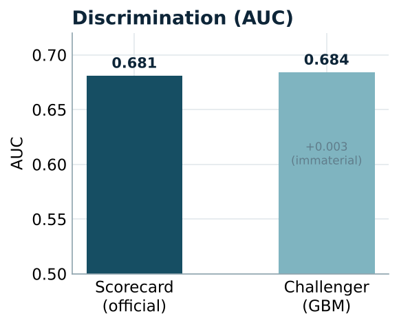
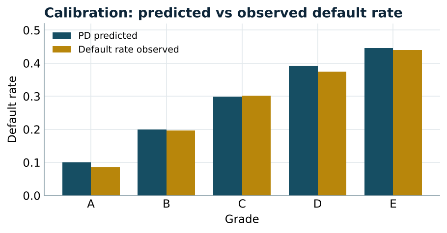
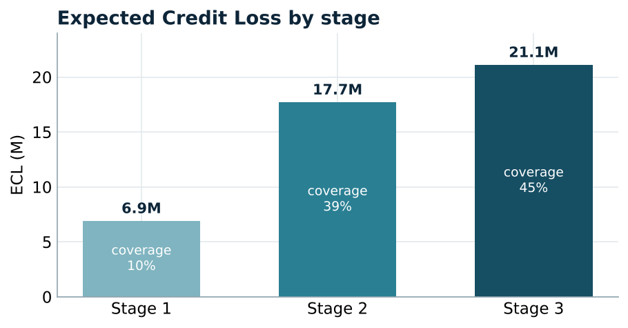
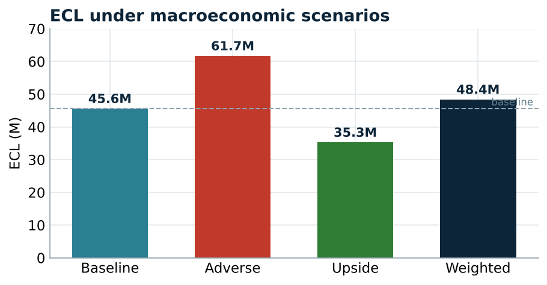

# IFRS 9 ECL Engine & Model-Challenge Dashboard

🚀 **[Live dashboard](https://arjinasim-ifrs9-ecl-engine-appstreamlit-app-9hdoqe.streamlit.app)** · 📄 **[Project report (PDF)](IFRS9_ECL_Project_Report.pdf)**

An end-to-end **expected-credit-loss (ECL)** engine for a loan portfolio, from the
PD model to committee reporting, together with the independent validation layer
that challenges it. The project plays both sides of a bank's risk function: the
first line that *produces* the number, and the second line that *contests* it.

Built on **real public data** (Lending Club) and runs end to end in Google Colab.

## The problem

Under IFRS 9, banks provision for **expected** credit losses, not just incurred
ones. This repository computes `ECL = PD × LGD × EAD`, classifies each exposure
into Stage 1 / 2 / 3, applies a forward-looking macro overlay, and ships a
dashboard so the result can be read and stress-tested by a committee.

## Pipeline

```
data → features → PD model → LGD/EAD → staging & SICR → ECL → macro overlay → validation → dashboard
```

Stages 3 to 7 are the "number production" core; the validation layer is the
second-line-of-defence that challenges it.

## Key results

*Lending Club sample: 21,668 resolved loans, observed default rate 26.9%.
Temporal split (train on the past, test on the future).*

### PD model — discrimination and the controller's call

| Model | AUC | Gini | KS |
| --- | --- | --- | --- |
| Logistic scorecard (official) | 0.681 | 0.361 | 0.273 |
| Gradient-boosting challenger | 0.684 | — | — |

The challenger beats the interpretable scorecard by only **0.003 of AUC**, an
immaterial gain, so the scorecard is retained as the official model. SHAP
confirms the challenger relies on sensible drivers (interest rate, loan amount,
FICO, DTI), in the expected directions.



### Calibration — backtest by grade

| Grade | PD predicted | Default rate observed | Gap |
| --- | --- | --- | --- |
| A | 0.100 | 0.086 | +0.014 |
| B | 0.199 | 0.197 | +0.002 |
| C | 0.299 | 0.302 | −0.003 |
| D | 0.393 | 0.375 | +0.017 |
| E | 0.446 | 0.440 | +0.006 |

Predicted and observed default rates are close and monotonic across the main
grades (gaps widen only for the sparse F/G grades, n < 200).



### Expected Credit Loss by stage

| Stage | Exposures | EAD | ECL | Coverage |
| --- | --- | --- | --- | --- |
| 1 | 5,557 | 67.1M | 6.9M | 10% |
| 2 | 2,518 | 45.3M | 17.7M | 39% |
| 3 | 2,874 | 46.8M | 21.1M | 45% |
| **Total** | **10,949** | **159.2M** | **45.6M** | **29%** |



### Forward-looking macro overlay (probability-weighted ECL)

| Scenario | Weight | ECL |
| --- | --- | --- |
| Baseline | 0.5 | 45.6M |
| Adverse | 0.3 | 61.7M |
| Upside | 0.2 | 35.3M |
| **Weighted** | **1.0** | **48.4M** |

A stressed macro scenario lifts provisions by **+35%** versus baseline, exactly
the sensitivity a provisioning committee needs to monitor.



## Repo layout

```
src/   ecl_engine.py (staging, SICR, ECL) · pd_model.py (scorecard + challenger)
       lgd_ead.py · macro_overlay.py · validation.py (AUC, PSI, calibration, backtest)
       data_prep_lendingclub.py (real Lending Club schema)
app/   streamlit_app.py — 4-tab dashboard (Portfolio, Scenarios, Counterparty, Monitoring)
tests/ test_ecl_engine.py — the engine is unit-tested (9 tests)
notebooks/ 01_lending_club_ecl.ipynb — the full Colab run
docs/  methodology.md — the one-page committee note, and the figures
```

## Quickstart

```bash
pip install -r requirements.txt
pip install deepchecks            # tokenless Lending Club sample
# run notebooks/01_lending_club_ecl.ipynb to build data/portfolio_with_ecl.parquet
pytest -q                         # 9 passing tests on the ECL engine
streamlit run app/streamlit_app.py
```

## Methodology choices (see `docs/methodology.md`)

- **Default** = Charged Off / Default; only resolved loans are modelled.
- **Two PD models**: an interpretable scorecard (official) and a gradient-boosting
  challenger; the scorecard is kept because the uplift is immaterial.
- **Staging**: Stage 3 on default/90dpd; Stage 2 on SICR (relative and absolute PD
  test, 30dpd backstop); the SICR threshold is a dashboard control.
- **Forward-looking**: PDs scaled across baseline / adverse / upside; ECL is the
  probability-weighted total.
- **Explainability**: SHAP audits the challenger.

## Limitations and next steps

- The `deepchecks` sample has no recovery data, so **LGD uses a documented 45%
  unsecured assumption**; the full Lending Club file would give observed LGD.
- Lifetime PD is proxied from the 12-month PD; a term-structure model is the
  production step.
- A bridge to the Basel IRB Expected Loss would let the ECL vs regulatory-EL gap
  be shown directly.

*Stating a model's own weaknesses explicitly is itself a second-line posture.*
